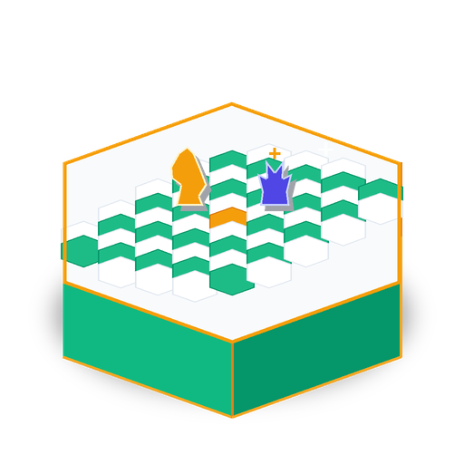

# Échecs — refonte hors ligne en cours

> Le client actuellement jouable est l'ancienne version desktop Pygame. Le nouveau client Godot est en construction. Les parties contre l'IA et les parties entre appareils proches sont conçues pour fonctionner sans compte ni Internet.

<p align="center">
  
</p>

<p align="center">
  <strong>Un jeu d'échecs hors ligne : IA locale, partie à deux et jeu à proximité sur réseau local.</strong>
</p>

<p align="center">
  <a href="#fonctionnalités"></a>
  <a href="#fonctionnalités"></a>
  <a href="#fonctionnalités"></a>
  <a href="#licence"></a>
</p>

---

## ✨ Points Forts & Fonctionnalités

* 🤖 **Partie contre une IA locale** : Stockfish peut être utilisé lorsqu'il est présent. Le niveau réel dépend du moteur livré avec le paquet; le mode de secours actuel n'offre pas la même force.
* ♟️ **Partie locale à deux** sur le même appareil.
* 📡 **Partie entre appareils proches** : l'ancien client découvre les hôtes par broadcast UDP sur le même réseau local. Il ne requiert pas Internet, mais ne sait pas encore établir un lien Wi‑Fi Direct sans routeur.
* 🎬 **Mouvements animés**, sélection et destinations légales, prise, échec, promotion et fin de partie.
* 🧭 **Fonctions avancées** de l'ancien client : pendules, historique et replay, annotations, indices, thèmes de plateau et chat LAN.

## État réel des plateformes

| Plateforme | État dans ce dépôt |
| --- | --- |
| Linux x86_64 | Paquet et exécutable présents; validation du lancement à effectuer |
| Windows | Exécutable/installeur présents; validation sur Windows à effectuer |
| macOS | Archive présente, mais son lanceur dépend de Python installé |
| Android | Configuration de packaging présente; aucun APK/AAB livré |
| iOS | Aucun projet ou IPA présent |

Les exports mobiles et la connexion de proximité sans routeur sont des objectifs de la refonte, pas des fonctions livrées aujourd'hui. Godot est le nouveau client visé parce qu'il est conçu pour les jeux et les interfaces tactiles; son prototype doit encore prouver le jeu complet et les exports. Le jeu n'utilisera pas de serveur IA ou de relais cloud.

---

## 🚀 Installation & Lancement

### 1. Prérequis
* Python 3.12 ou supérieur

### 2. Cloner et Lancer
```bash
git clone https://github.com/TheShellMaster/echecs-p2p-pro.git
cd echecs-p2p-pro
pip install -r requirements.txt
python3.12 main.py
```

### 3. Exécutables & Installeurs Autonomes
Les artefacts existants dans `distribution/` sont des builds historiques. Ils ne représentent pas encore une matrice de versions testées pour tous les appareils; voir le tableau ci-dessus.

---

## ⌨️ Raccourcis Clavier

| Touche | Action |
| :--- | :--- |
| `F` | Inverser la perspective de l'échiquier (Flip) |
| `M` | Couper / Activer les effets sonores (Mute) |
| `F11` | Basculer en mode Plein Écran |
| `←` / `→` | Naviguer dans l'historique des coups (Replay) |
| `Clic Droit` | Tracer une flèche ou entourer une case |
| `Clic Gauche` | Sélectionner / Jouer / Effacer les annotations |

---

## 📜 Licence

Distribué sous licence **MIT**. Libre d'utilisation, de modification et de distribution.
