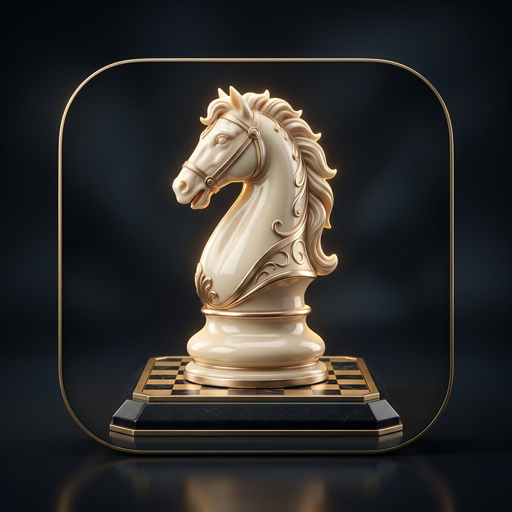

# Échecs 3D Pro

<p align="center">
  
</p>

<p align="center">
  <strong>Jeu d'échecs ultra-réaliste 3D hors ligne : pièces sculptées, animations cinématiques, IA Stockfish locale avec niveaux, et mode apprentissage avec coach.</strong>
</p>

<p align="center">
  
  
  
  
  
</p>

---

<p align="center">
  
  
</p>

---

## ✨ Points Forts & Fonctionnalités

* 👑 **Rendu 3D Ultra-Réaliste** : Pièces sculptées *Aster* (Blender), matériaux PBR (ivoire chaud, or brossé, bois verni), ombres portées douces et éclairage cinématique.
* 🎬 **Animations Fluides & Slow-Motion** : 
  * Déplacements en cloche réalistes avec rebond d'atterrissage et ondes au sol.
  * Captures renversées au ralenti avec zoom dynamique de la caméra.
  * Effets d'échec pulsés en lumière rouge et bascule dramatique du Roi au mat.
  * Menus interactifs en slow-motion avec rejeu de la partie de l'Opéra (1858) en arrière-plan et effet *bullet time* au survol.
* 🤖 **IA Hors Ligne & 4 Niveaux de Difficulté** :
  * Intégration directe du moteur **Stockfish 19** local via pipe UCI avec repli automatique sur moteur Minimax GDScript.
  * **Niveau 1** · Débutant (~800 ELO)
  * **Niveau 2** · Intermédiaire (~1400 ELO)
  * **Niveau 3** · Avancé (~1900 ELO)
  * **Niveau 4** · Grand Maître (~2500 ELO)
* 🎓 **Mode Apprentissage & Coach Interactif** :
  * ✦ **Indice dynamique** : Calcul du meilleur coup suggéré avec visualisation cyan sur l'échiquier 3D et explication tactique.
  * ◈ **Coach pédagogique** : Analyse en direct de la position, calcul du bilan matériel, détection des menaces adverses et conseils stratégiques (ouverture, milieu de jeu, finale).
* 🌐 **Partie à deux & Proximité Locale** :
  * Mode à deux joueurs en local sur le même écran.
  * Mode réseau local (découverte UDP / partie TCP) 100% sans Internet.
* 🔒 **100% Hors Ligne & Respect de la Vie Privée** : Aucun compte requis, aucune collecte, vos parties restent sur votre machine.

---

## 🚀 Lancement & Installation

### Lancement direct sur ce PC
Un raccourci a été installé directement sur votre Bureau (`Bureau/Echecs3D.desktop`) et dans votre menu d'applications. Double-cliquez simplement pour jouer !

### Lancer depuis les sources
```sh
godot --path godot
```

### Vérifier le moteur de règles
```sh
godot --headless --path godot --script res://core/verify_chess_game.gd
```

---

## 📦 Téléchargements & Versions Compilées

Des versions autonomes pré-compilées sont disponibles dans le dossier `release/` :
* **Linux x86_64** : `release/Echecs3D-Linux-x86_64.tar.gz` (exécutable autonome + Stockfish local + lanceur).
* **Windows x64** : `release/Echecs3D-Windows-x64.zip` (exécutable .exe + Stockfish local).

---

## 📚 Documentation Complète

* [Guide du Joueur](docs/GUIDE_JOUEUR.md) : Prise en main, règles, commandes et raccourcis.
* [Architecture Technique](docs/ARCHITECTURE.md) : Structure des modules Godot 3D et flux réseau.
* [Guide Développeur](docs/DEVELOPPEMENT.md) : Compilation, exports et tests.
* [Feuille de Route](docs/FEUILLE_DE_ROUTE.md) : Suivi des fonctionnalités.
* [Journal des Modifications](CHANGELOG.md) : Historique des versions.
