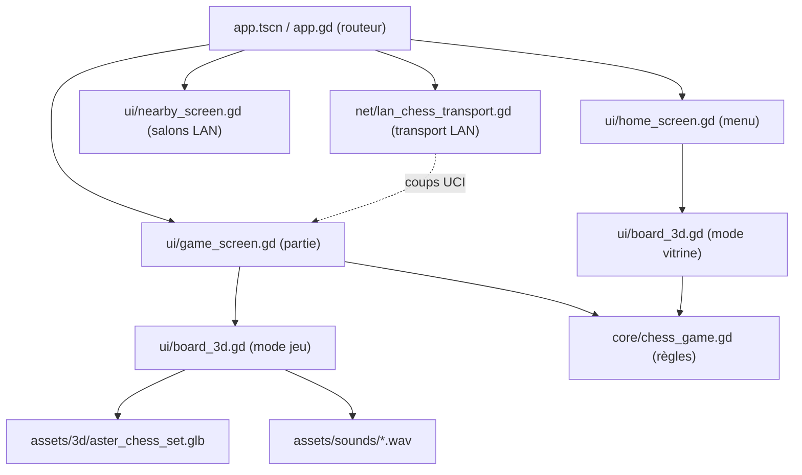

# Architecture

Le dépôt contient deux clients. Le client **Godot** (`godot/`) est la nouvelle direction du produit. Le client **Pygame** (racine) sert de référence fonctionnelle jusqu'à la parité des fonctions.

## Client Godot



Le démarrage réel passe par `app.tscn` → `app.gd`. **`main.tscn` n'est pas utilisé.**

### Responsabilités

| Fichier | Rôle |
| --- | --- |
| `app.gd` | Routeur des écrans, transitions en fondu, propriétaire du transport LAN. |
| `core/chess_game.gd` | `ChessGame` : règles complètes (roque, prise en passant, promotion, SAN, FEN, annulation et rétablissement, nulles). Il ne dépend ni de l'interface, ni du réseau, ni de l'IA. |
| `core/verify_chess_game.gd` | Vérificateur autonome des règles. |
| `ui/board_3d.gd` | `Board3D` : scène 3D, synchronisation des pièces, animations, sélection par rayon, glisser-déposer, caméra, sons, mode vitrine. |
| `ui/game_screen.gd` | Logique de partie (IA, local, proximité), panneau latéral, IA minimax de secours. |
| `ui/home_screen.gd` | Menu cinématique sur scène 3D, ralenti au survol, transition de sortie. |
| `ui/nearby_screen.gd` | Liste et création des salons sur le réseau local. |
| `net/lan_chess_transport.gd` | Découverte par UDP et partie par TCP. Messages avec identifiant de partie, numéro de coup (`ply`) et coup UCI. |
| `tools/capture_screens.gd` | Captures d'écran automatiques pour la documentation et la vérification visuelle. |

### Conventions

- Cases : **a8 = 0 → h1 = 63** (python-chess utilise a1 = 0).
- Pièces : lettres FEN, majuscules pour les Blancs.
- Rendu : Godot 4.4 avec le moteur **GL Compatibility**, pour la cohérence desktop et mobile. Ombres et lueur (glow) actives, anticrénelage MSAA ×4 dans le `SubViewport`.

### Contrat de `Board3D`

```gdscript
signal square_pressed(square: int)
func set_board_state(pieces: Array, selected: int, legal: Array, last_move: Vector2i, checked: int)
func animate_move(from_square: int, to_square: int, piece: String)  # marque le coup principal (arc)
func play_game_over(king_square: int)
func set_time_scale(value: float, duration := 0.6)                 # bullet time
var showcase: bool      # mode vitrine du menu
var slow_factor: float  # multiplicateur de durée (ralenti)
```

**Synchronisation par différence.** `_sync()` est différé d'une image, donc l'ordre d'appel entre `set_board_state` et `animate_move` n'a pas d'importance. Il rapproche l'ancien et le nouvel état en plusieurs étapes :

1. le coup principal ;
2. les pièces inchangées ;
3. les glissements entre pièces de même type, ce qui couvre le roque, l'annulation et le rétablissement ;
4. les captures ;
5. l'apparition des nouvelles pièces.

La promotion remplace le maillage à l'atterrissage.

**Temps.** Chaque tween passe par `_new_tween()`. Son `speed_scale` suit `_time_scale`, ce qui permet de ralentir toute la scène sans toucher à `Engine.time_scale`.

**Sélection.** Un rayon partant de la caméra est intersecté avec le plan `y = 0`, sans moteur physique. La sélection reste donc juste quand la caméra bouge ou qu'on retourne le plateau.

### Assets

- `assets/3d/aster_chess_set.glb` est généré par `assets/3d/build_chess_set.py` avec `blender --background --python build_chess_set.py`. Il contient 12 racines nommées `Aster_<White|Black>_<Piece>`, avec le pied à Y = 0 et une case de 1 m.
- `assets/sounds/` contient des copies des sons du client historique.

## Client Pygame (historique)

`main.py` / `GameApp` coordonne python-chess, l'interface Pygame (`ui.py`, `modals.py`, `animations.py`), `ai.py` (Stockfish en UCI, avec repli) et `network.py` (découverte par UDP, partie par TCP). Les tests Python à la racine ne couvrent que ce client.
