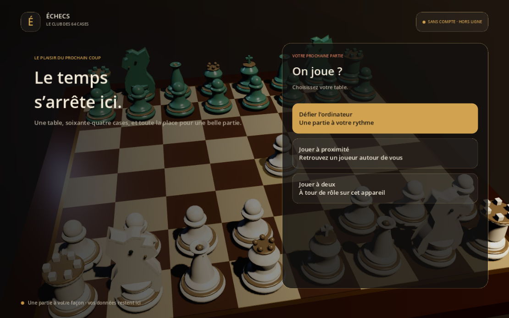
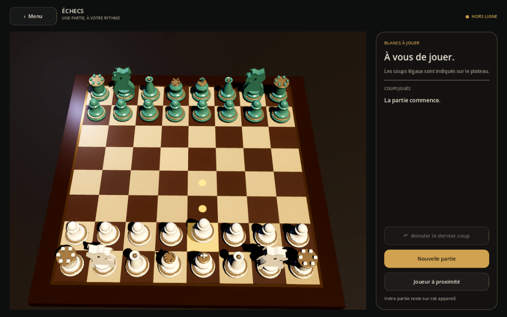

# Guide du joueur — client 3D (Godot)

Ce guide décrit le client Godot tel qu'il fonctionne aujourd'hui. Les fonctions qui ne sont pas encore livrées sont signalées par **(à venir)**. Elles sont détaillées dans la [feuille de route](FEUILLE_DE_ROUTE.md).



## Lancer le jeu

```sh
godot --path godot
```

Aucun compte ni connexion Internet n'est demandé. Les règles, l'IA et les parties restent sur votre appareil.

## Le menu

- En fond, la **scène 3D rejoue au ralenti la partie de l'Opéra** (Morphy, 1858), avec une caméra qui tourne autour du plateau.
- Les éléments du menu apparaissent en cascade, lentement.
- **Survolez un bouton** : la scène ralentit fortement (effet *bullet time*).
- **Cliquez sur un choix** : le temps se fige, l'image zoome, puis la partie s'ouvre.

| Bouton | Effet |
| --- | --- |
| Défier l'ordinateur | Partie contre l'IA locale. Vous jouez les Blancs. |
| Jouer à proximité | Recherche ou création d'une partie sur le même réseau Wi-Fi, sans Internet. |
| Jouer à deux | Deux joueurs à tour de rôle sur le même appareil. |
| Continuer la partie | Visible seulement si une sauvegarde existe **(sauvegarde à venir)**. |

## Jouer un coup



- **Cliquer-cliquer** : touchez une pièce, puis la case d'arrivée.
- **Glisser-déposer** : maintenez la pièce, déplacez-la, relâchez-la sur la case voulue. Si le coup est illégal, elle revient en place.
- **Survol** : la pièce sous le curseur se soulève légèrement.
- La pièce sélectionnée flotte. Les **points dorés** marquent les cases libres atteignables, les **anneaux dorés** les captures possibles.
- Le dernier coup reste surligné en ambre.

## Ce que montrent les animations

| Événement | Animation |
| --- | --- |
| Déplacement | La pièce suit un arc et atterrit avec un rebond, puis une onde se forme au sol. Le cavalier saute plus haut. |
| Capture | Le coup passe au ralenti. La pièce prise est renversée puis disparaît, et la caméra fait un petit zoom à l'impact. |
| Roque, prise en passant | La tour, ou le pion pris, est animé lui aussi. |
| Promotion | La pièce change de forme à l'atterrissage, avec un éclat doré. Le choix de la pièce est **à venir** : c'est une dame pour l'instant. |
| Échec | La case du roi pulse en rouge, éclairée par une lumière rouge. |
| Échec et mat | Le roi vaincu bascule au ralenti pendant que la caméra se rapproche. |
| Ouverture d'une partie | La caméra plonge vers le plateau. |

## Panneau latéral

- Le trait (« Blancs à jouer » ou « Noirs à jouer ») et l'état de la partie.
- La liste des coups en notation algébrique (SAN).
- **Annuler le dernier coup** : contre l'IA, cela annule aussi la réponse de l'IA. Indisponible en partie à proximité.
- **Nouvelle partie**, et **Joueur à proximité**.

## L'IA

Aujourd'hui, l'IA du client Godot est un minimax alpha-bêta en GDScript (profondeur 2), entièrement hors ligne. Elle attend que votre pièce ait atterri avant de répondre. Les **niveaux** et l'utilisation de **Stockfish** en local sont **à venir**. Godot sait déjà piloter Stockfish : un essai réel a renvoyé un coup (`bestmove`).

## Fins de partie reconnues

Mat, pat, matériel insuffisant, règle des 75 coups et quintuple répétition terminent la partie automatiquement. La règle des 50 coups et la triple répétition sont seulement *réclamables*. Elles sont exposées par le cœur de règles, mais pas encore affichées dans l'interface.

## Partie à proximité

1. Les deux appareils sont sur le **même réseau local**. Internet n'est pas nécessaire.
2. L'un crée un salon, l'autre le rejoint dans la liste.
3. Chaque coup est vérifié des deux côtés. Un coup illégal, ou reçu hors séquence, arrête la partie.

Une connexion directe sans routeur (Wi-Fi Direct, proximité Apple) n'est pas encore disponible.

## Client historique (Pygame)

L'ancien client reste jouable avec `python3.12 main.py`. Il propose déjà Stockfish, des niveaux, un coach, des pendules, le replay et le chat en réseau local. C'est la référence fonctionnelle tant que le portage vers Godot n'est pas terminé.
