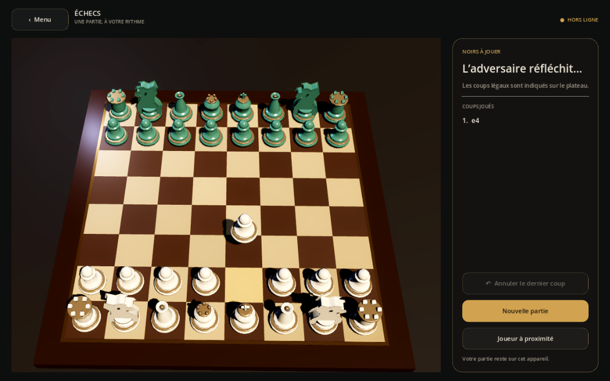

# Documentation

| Document | Pour qui | Contenu |
| --- | --- | --- |
| [Guide du joueur](GUIDE_JOUEUR.md) | Joueurs | Menu, coups, animations, modes de jeu |
| [Architecture](ARCHITECTURE.md) | Développeurs | Rôle de chaque module, contrat de `Board3D`, conventions |
| [Développement](DEVELOPPEMENT.md) | Développeurs | Installation, commandes, tests, pièges GDScript, paquets |
| [Feuille de route](FEUILLE_DE_ROUTE.md) | Tous | Ce qui est livré, partiel ou à faire |
| [Journal des modifications](../CHANGELOG.md) | Tous | Historique des versions |
| [Refonte produit](../PRODUCT_REBOOT.md) | Produit | Exigences et décisions |
| [Règles (cœur)](../godot/core/README.md) | Développeurs | API de `ChessGame` |

